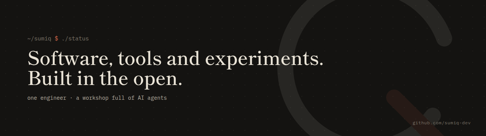

**sumiq** is a one-person software company that runs like a lab: it builds products, ships them, and puts the whole process on record — the wins and the wreckage.

```
~/sumiq $ ./status

  OUTPUT
  SQ-001   Study Algorithm    prototype   study app for your own material
  SQ-002   agent-workflows    planned     how sumiq builds with AI coding agents
  SQ-003   selfhost-kit       planned     docker · caddy · backups that restore

  EXPERIMENTS
  EXP-001  running   does a guided study method beat simply studying harder?
  EXP-002  running   how much of a real product can AI agents build?
  EXP-003  queued    can one person run their own infrastructure?

  HEADCOUNT
  1 engineer · several AI agents (unpaid, tireless, occasionally wrong)
```

### Channels

| | |
|---|---|
| `CH-01` | [YouTube](https://www.youtube.com/@sumiq-dev) — the builds, start to finish, on camera |
| `CH-02` | [X](https://x.com/sumiq_dev) — the day-to-day: what got built, what broke |
| `CH-03` | GitHub — you are here |
| `CH-04` | [sumiq.dev](https://sumiq.dev) — the permanent record |

<sub>est. 2026</sub>
